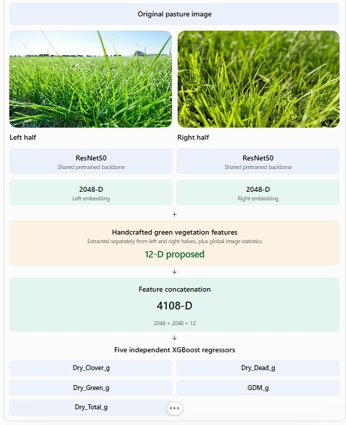

Farmers often walk into a paddock and ask one question: “Is there enough grass here for the herd?” It sounds simple, but the answer is anything but. Pasture biomass - the amount of feed available - shapes when animals can graze, when fields need a break, and how to keep pastures productive season after season.

Estimate incorrectly, and the land suffers; feed goes to waste, and animals struggle. Get it right and everyone wins: better animal welfare, more consistent production, and healthier soils.

Current methods make this assessment more challenging than it could be. The old-school “clip and weigh” method is accurate but slow and impossible at scale. Plate meters and capacitance meters can provide quicker readings, but are unreliable in variable conditions. Remote sensing enables broad-scale monitoring, but it still requires manual validation and can’t separate biomass by species.

This competition challenges you to bring greener solutions to the field: build a model that predicts pasture biomass from images, ground-truth measures, and publicly available datasets. You’ll work with a professionally annotated dataset covering Australian pastures across different seasons, regions, and species mixes, along with NDVI values to enhance your models.

If you succeed, you won’t just improve estimation methods. You’ll help farmers make smarter grazing choices, enable researchers to track pasture health more accurately, and drive the agriculture industry toward more sustainable and productive system

Problme raised by Commonwealth Scientific and Industrial Research Organization

https://www.csiro.au

Problem statement above 

Solutions :-
Baselines :
I will give you codes and you have to draw rough architecture diagrams from them

Most basic baselines 
We had to predcit 5 things 
productive systems.

Evaluation
Scoring
The model performance is evaluated using a globally weighted coefficient of determination (R²) computed over all (image, target) pairs together.
Each row is weighted according to its target type using the following weights:

Dry_Green_g: 0.1
Dry_Dead_g: 0.1
Dry_Clover_g: 0.1
GDM_g: 0.2
Dry_Total_g: 0.5
This means that instead of calculating R² separately for each target and then averaging, a single weighted R² is computed using all rows combined, with the above per-row weights applied.

Most basic  baselins 
5

============================================================
# COMPLETE TRAINING + INFERENCE SCRIPT
# CNN EMBEDDINGS + ExG + GNDVI → XGBOOST
# ============================================================

import os
import torch
import joblib
import xgboost as xgb
import pandas as pd
import numpy as np

from PIL import Image
from torch.utils.data import Dataset, DataLoader
from torchvision import models, transforms

# ============================================================
# CONFIG
# ============================================================

DEVICE = "cuda" if torch.cuda.is_available() else "cpu"

IMG_ROOT = "/kaggle/input/csiro-biomass/"
TRAIN_CSV = "/kaggle/input/csiro-biomass/train.csv"
TEST_CSV  = "/kaggle/input/csiro-biomass/test.csv"

BATCH_SIZE = 32

class ResNetBackbone(nn.Module):
    def __init__(self):
        super().__init__()
        self.model = models.resnet50(pretrained=True)
        self.model.fc = nn.Identity()  # remove classifier

    def forward(self, x):
        return self.model(x)

# ============================================================
# CNN BACKBONE (EMBEDDING MODEL)
# ============================================================

cnn_model = torch.load(
    "/kaggle/input/embedding/pytorch/default/1/backbone_full.pt",
    map_location=DEVICE,
    weights_only=False
)
cnn_model.eval()

# ============================================================
# IMAGE TRANSFORMS
# ============================================================

transform = transforms.Compose([
    transforms.Resize((224, 224)),
    transforms.ToTensor(),
    transforms.Normalize(
        mean=[0.485, 0.456, 0.406],
        std=[0.229, 0.224, 0.225]
    )
])

# ============================================================
# DATASET
# ============================================================

class ImgDataset(Dataset):
    def __init__(self, df):
        self.df = df.reset_index(drop=True)

    def __len__(self):
        return len(self.df)

    def __getitem__(self, idx):
        img = Image.open(
            os.path.join(IMG_ROOT, self.df.loc[idx, "image_path"])
        ).convert("RGB")
        return transform(img)

# ============================================================
# CNN EMBEDDING EXTRACTION
# ============================================================

def extract_embeddings(df):
    loader = DataLoader(
        ImgDataset(df),
        batch_size=BATCH_SIZE,
        shuffle=False
    )

    feats = []
    with torch.no_grad():
        for x in loader:
            x = x.to(DEVICE)
            feats.append(cnn_model(x).cpu().numpy())

    return np.vstack(feats)   # [N, 2048]

# ============================================================
# GREEN FEATURE EXTRACTION
# ============================================================

def compute_green_features(img_path):
    img = np.array(Image.open(img_path).convert("RGB")).astype(np.float32)

    R = img[..., 0]
    G = img[..., 1]
    B = img[..., 2]

    # ExG
    exg = 2 * G - R - B
    exg_mean = exg.mean()
    exg_std = exg.std()
    exg_top10 = exg[exg >= np.percentile(exg, 90)].mean()

    # GNDVI proxy
    eps = 1e-6
    gndvi = (G - R) / (G + R + eps)
    gndvi_mean = gndvi.mean()

    return np.array(
        [exg_mean, exg_std, exg_top10, gndvi_mean],
        dtype=np.float32
    )

def extract_green_features(df):
    feats = []
    for p in df["image_path"]:
        feats.append(
            compute_green_features(os.path.join(IMG_ROOT, p))
        )
    return np.vstack(feats)   # [N, 4]

# ============================================================
# ===================== TRAINING =============================
# ============================================================

train_df = pd.read_csv(TRAIN_CSV)

print("🔍 Extracting CNN embeddings...")
train_img_emb = extract_embeddings(train_df)

print("🌿 Extracting green features...")
train_green = extract_green_features(train_df)

# Final feature vector
X_full = np.hstack([train_img_emb, train_green])  # [N, 2052]

# Train separate model per target_name
target_groups = train_df["target_name"].unique()
joblib.dump(target_groups.tolist(), "target_groups2.pkl")

for g in target_groups:
    idx = train_df["target_name"] == g

    X = X_full[idx]
    y = train_df.loc[idx, "target"].values

    model = xgb.XGBRegressor(
        n_estimators=600,
        max_depth=8,
        learning_rate=0.05,
        subsample=0.85,
        colsample_bytree=0.85,
        objective="reg:squarederror",
        n_jobs=-1
    )

    model.fit(X, y)
    model.save_model(f"xgb_{g}.json")

print("✅ XGBoost training completed")

# ============================================================
# ===================== INFERENCE =============================
# ============================================================

# Load trained models
target_groups = joblib.load("target_groups2.pkl")

xgb_models = {}
for g in target_groups:
    base_g = g[::-1].replace("_", "", 1)[::-1]
    m = xgb.XGBRegressor()
    m.load_model(f"/kaggle/input/xgboost-with-color/scikitlearn/default/1/xgb_{base_g}.json")
    xgb_models[g] = m

def extract_features_single(img_path):
    img = Image.open(img_path).convert("RGB")
    x = transform(img).unsqueeze(0).to(DEVICE)

    with torch.no_grad():
        cnn_emb = cnn_model(x).cpu().numpy()

    green_feat = compute_green_features(img_path).reshape(1, -1)

    return np.hstack([cnn_emb, green_feat])

test_df = pd.read_csv(TEST_CSV)
preds = []

for _, row in test_df.iterrows():
    feat = extract_features_single(
        os.path.join(IMG_ROOT, row["image_path"])
    )

    model = xgb_models[row["target_name"]]
    preds.append(model.predict(feat)[0])

submission = pd.DataFrame({
    "sample_id": test_df["sample_id"],
    "target": preds
})

submission.to_csv("submission.csv", index=False)
print("📤 submission.csv generated successfully")
imporve model based on resnet + green features + xgboost

Next model changed ot DINO 
# =====================================================
# BIOMASS PREDICTION – FINAL (FIXED DINO USAGE)
# Image + Target-Name Conditioning
# DINO ViT-S/16 (Full Image, No Manual Patchify)
# =====================================================

import os
import torch
import torch.nn as nn
import torch.nn.functional as F
from torch.utils.data import Dataset, DataLoader
from torchvision import transforms
from PIL import Image
import timm
import pandas as pd
from sklearn.preprocessing import LabelEncoder

# =====================================================
# CONFIG
# =====================================================
DEVICE = "cuda" if torch.cuda.is_available() else "cpu"
IMG_SIZE = 224
BATCH_SIZE = 8
EPOCHS = 10
LR = 1e-4

TRAIN_CSV = "/kaggle/input/csiro-biomass/train.csv"
TEST_CSV  = "/kaggle/input/csiro-biomass/test.csv"
DATA_ROOT = "/kaggle/input/csiro-biomass"
DINO_CKPT = "/kaggle/input/dinoembed/pytorch/default/1/dino_deitsmall16_pretrain (1).pth"

# =====================================================
# TARGET NAME VOCAB
# =====================================================
TARGET_NAME_TO_ID = {
    "Dry_Clover_g": 0,
    "Dry_Dead_g": 1,
    "Dry_Green_g": 2,
    "Dry_Total_g": 3,
    "GDM_g": 4,
}
NUM_TARGET_NAMES = len(TARGET_NAME_TO_ID)

# =====================================================
# LOAD DATA
# =====================================================
train_df = pd.read_csv(TRAIN_CSV)
test_df  = pd.read_csv(TEST_CSV)

# =====================================================
# LABEL ENCODING
# =====================================================
species_encoder = LabelEncoder()
state_encoder   = LabelEncoder()

train_df["Species"] = species_encoder.fit_transform(train_df["Species"])
train_df["State"]   = state_encoder.fit_transform(train_df["State"])

if "Species" in test_df.columns:
    test_df["Species"] = species_encoder.transform(test_df["Species"])
if "State" in test_df.columns:
    test_df["State"] = state_encoder.transform(test_df["State"])

NUM_SPECIES = train_df["Species"].nunique()
NUM_STATES  = train_df["State"].nunique()

print(f"✅ Species classes: {NUM_SPECIES}, State classes: {NUM_STATES}")

# =====================================================
# GREEN FEATURE EXTRACTOR
# =====================================================
class GreenFeatureExtractor(nn.Module):
    def forward(self, x):
        R, G, B = x[:, 0], x[:, 1], x[:, 2]
        exg = 2 * G - R - B
        green_ratio = (G > R).float().mean(dim=[1, 2])
        return torch.stack(
            [G.mean(dim=[1, 2]), exg.mean(dim=[1, 2]), green_ratio], dim=1
        )

# =====================================================
# CROSS ATTENTION
# =====================================================
class CrossAttention(nn.Module):
    def __init__(self, dim, heads):
        super().__init__()
        self.attn = nn.MultiheadAttention(dim, heads, batch_first=True)
        self.norm = nn.LayerNorm(dim)

    def forward(self, q, kv):
        out, _ = self.attn(q, kv, kv)
        return self.norm(out + q)

# =====================================================
# BIOMASS MODEL (FIXED)
# =====================================================
class BiomassModel(nn.Module):
    def __init__(
        self,
        embed_dim=384,
        num_heads=6,
        num_layers=4,
        target_emb_dim=128,
        num_species=1,
        num_states=1,
    ):
        super().__init__()

        # ---- DINO ViT-S/16 ----
        self.dino = timm.create_model(
            "vit_small_patch16_224",
            pretrained=False,
            num_classes=0,
        )
        ckpt = torch.load(DINO_CKPT, map_location="cpu")
        self.dino.load_state_dict(ckpt, strict=False)

        for p in self.dino.parameters():
            p.requires_grad = False

        # 196 tokens (14x14)
        self.pos_embed = nn.Parameter(torch.randn(1, 196, embed_dim))

        encoder_layer = nn.TransformerEncoderLayer(
            d_model=embed_dim,
            nhead=num_heads,
            batch_first=True,
        )
        self.transformer = nn.TransformerEncoder(
            encoder_layer, num_layers=num_layers
        )

        # ---- Green Features ----
        self.green_extractor = GreenFeatureExtractor()
        self.green_proj = nn.Linear(3, embed_dim)
        self.cross_attn = CrossAttention(embed_dim, num_heads)

        # ---- Target Name Conditioning ----
        self.target_embedding = nn.Embedding(NUM_TARGET_NAMES, target_emb_dim)
        self.target_proj = nn.Linear(target_emb_dim, embed_dim)

        fused_dim = embed_dim * 2

        # ---- Heads ----
        self.biomass_head = nn.Sequential(
            nn.Linear(fused_dim, 256),
            nn.ReLU(),
            nn.Linear(256, 1),
        )
        self.height_head  = nn.Linear(fused_dim, 1)
        self.aux_head     = nn.Linear(fused_dim, 1)
        self.species_head = nn.Linear(fused_dim, num_species)
        self.state_head   = nn.Linear(fused_dim, num_states)

    def forward(self, image, target_name_id):
        # ---- DINO token extraction ----
        tokens = self.dino.forward_features(image)  # (B, 197, D)
        tokens = tokens[:, 1:, :]                   # remove CLS → (B, 196, D)

        tokens = tokens + self.pos_embed
        tokens = self.transformer(tokens)

        # ---- Green conditioning ----
        green = self.green_extractor(image)
        green = self.green_proj(green).unsqueeze(1)
        img_ctx = self.cross_attn(green, tokens).squeeze(1)

        # ---- Target conditioning ----
        tgt = self.target_proj(self.target_embedding(target_name_id))

        fused = torch.cat([img_ctx, tgt], dim=1)

        return {
            "biomass": self.biomass_head(fused).squeeze(1),
            "height":  self.height_head(fused).squeeze(1),
            "aux":     self.aux_head(fused).squeeze(1),
            "species": self.species_head(fused),
            "state":   self.state_head(fused),
        }

# =====================================================
# DATASETS
# =====================================================
class BiomassDataset(Dataset):
    def __init__(self, df, transform):
        self.df = df.reset_index(drop=True)
        self.transform = transform

    def __len__(self):
        return len(self.df)

    def __getitem__(self, idx):
        r = self.df.iloc[idx]
        image = Image.open(
            os.path.join(DATA_ROOT, r["image_path"])
        ).convert("RGB")
        image = self.transform(image)

        return {
            "image": image,
            "target": torch.tensor(r["target"], dtype=torch.float32),
            "target_name": torch.tensor(TARGET_NAME_TO_ID[r["target_name"]]),
            "species": torch.tensor(r["Species"], dtype=torch.long),
            "state": torch.tensor(r["State"], dtype=torch.long),
            "height": torch.tensor(r["Height_Ave_cm"], dtype=torch.float32),
            "aux": torch.tensor(r["Pre_GSHH_NDVI"], dtype=torch.float32),
        }

class BiomassTestDataset(Dataset):
    def __init__(self, df, transform):
        self.df = df.reset_index(drop=True)
        self.transform = transform

    def __len__(self):
        return len(self.df)

    def __getitem__(self, idx):
        r = self.df.iloc[idx]
        image = Image.open(
            os.path.join(DATA_ROOT, r["image_path"])
        ).convert("RGB")
        image = self.transform(image)

        return {
            "image": image,
            "target_name": torch.tensor(TARGET_NAME_TO_ID[r["target_name"]]),
            "id": r["sample_id"],
        }

# =====================================================
# TRAINING
# =====================================================
LOSS_W = dict(biomass=1.0, height=0.3, aux=0.2, species=0.1, state=0.1)

def train_one_epoch(model, loader, optimizer):
    model.train()
    total = 0.0

    for b in loader:
        img = b["image"].to(DEVICE)
        tgt = b["target"].to(DEVICE)
        tn  = b["target_name"].to(DEVICE)

        out = model(img, tn)

        loss = (
            LOSS_W["biomass"] * F.mse_loss(out["biomass"], tgt) +
            LOSS_W["height"]  * F.mse_loss(out["height"], b["height"].to(DEVICE)) +
            LOSS_W["aux"]     * F.mse_loss(out["aux"], b["aux"].to(DEVICE)) +
            LOSS_W["species"] * F.cross_entropy(out["species"], b["species"].to(DEVICE)) +
            LOSS_W["state"]   * F.cross_entropy(out["state"], b["state"].to(DEVICE))
        )

        optimizer.zero_grad()
        loss.backward()
        optimizer.step()

        total += loss.item()

    return total / len(loader)

# =====================================================
# SUBMISSION
# =====================================================
@torch.no_grad()
def generate_submission(model, loader, out_path="submission.csv"):
    model.eval()
    ids, preds = [], []

    for b in loader:
        out = model(b["image"].to(DEVICE), b["target_name"].to(DEVICE))
        ids.extend(b["id"])
        preds.extend(out["biomass"].cpu().numpy())

    pd.DataFrame({"id": ids, "biomass": preds}).to_csv(out_path, index=False)
    print(f"✅ Saved {out_path}")

# =====================================================
# RUN
# =====================================================
transform = transforms.Compose([
    transforms.Resize((IMG_SIZE, IMG_SIZE)),
    transforms.ToTensor(),
])

train_loader = DataLoader(
    BiomassDataset(train_df, transform),
    batch_size=BATCH_SIZE,
    shuffle=True,
)

test_loader = DataLoader(
    BiomassTestDataset(test_df, transform),
    batch_size=BATCH_SIZE,
)

model = BiomassModel(
    num_species=NUM_SPECIES,
    num_states=NUM_STATES,
).to(DEVICE)

optimizer = torch.optim.AdamW(model.parameters(), lr=LR)

EPOCHS = 150
SAVE_EVERY = 10

for e in range(EPOCHS):
    loss = train_one_epoch(model, train_loader, optimizer)
    print(f"Epoch {e+1}/{EPOCHS} | Loss: {loss:.4f}")

    if (e + 1) % SAVE_EVERY == 0:
        ckpt_path = f"biomass_model_epoch_{e+1}.pth"
        torch.save({
            "epoch": e + 1,
            "model_state_dict": model.state_dict(),
            "optimizer_state_dict": optimizer.state_dict(),
            "loss": loss,
        }, ckpt_path)
        print(f"💾 Saved checkpoint: {ckpt_path}")

print("✅ Training complete")

generate_submission(model, test_loader)
✅ Species classes: 15, State classes: 4
Epoch 1/150 | Loss: 671.9692
Epoch 2/150 | Loss: 341.9774
Epoch 3/150 | Loss: 254.9341
Epoch 4/150 | Loss: 233.0582
Epoch 5/150 | Loss: 209.1290
Epoch 6/150 | Loss: 211.7680
Epoch 7/150 | Loss: 225.1447
Epoch 8/150 | Loss: 208.3313
Epoch 9/150 | Loss: 237.6887
Epoch 10/150 | Loss: 232.0065
💾 Saved checkpoint: biomass_model_epoch_10.pth
Epoch 11/150 | Loss: 231.9213
Epoch 12/150 | Loss: 231.6788
Epoch 13/150 | Loss: 235.6365
Epoch 14/150 | Loss: 216.2566
Epoch 15/150 | Loss: 209.4557
Epoch 16/150 | Loss: 205.5899
Epoch 17/150 | Loss: 197.7897
Epoch 18/150 | Loss: 192.8348
Epoch 19/150 | Loss: 216.3776
Epoch 20/150 | Loss: 308.7143
💾 Saved checkpoint: biomass_model_epoch_20.pth
Epoch 21/150 | Loss: 392.1470
Epoch 22/150 | Loss: 502.8615
Epoch 23/150 | Loss: 464.2915
Epoch 24/150 | Loss: 455.0926

t("✅ submission.csv written successfully")
import os, gc, cv2, random
import numpy as np
import pandas as pd
import timm
import torch
import torch.nn as nn
from torch.utils.data import Dataset, DataLoader
from sklearn.model_selection import StratifiedKFold
from sklearn.preprocessing import LabelEncoder
import albumentations as A
from albumentations.pytorch import ToTensorV2

# =====================================================
# CONFIG
# =====================================================
class CONFIG:
    base_path = "/kaggle/input/csiro-biomass"
    train_csv = f"{base_path}/train.csv"
    test_csv  = f"{base_path}/test.csv"
    data_dir  = base_path

    img_size = 224
    batch_size = 8
    epochs = 30
    lr = 1e-3
    n_folds = 5
    seed = 42

    device = "cuda" if torch.cuda.is_available() else "cpu"

    targets_3 = ["Dry_Clover_g", "Dry_Dead_g", "Dry_Green_g"]
    target_cols = ["Dry_Clover_g", "Dry_Dead_g", "Dry_Green_g", "Dry_Total_g", "GDM_g"]

    dino_ckpt = "/kaggle/input/dinoembed/pytorch/default/1/dino_deitsmall16_pretrain (1).pth"
    ckpt_dir = "/kaggle/input/check/pytorch/default/1"

config = CONFIG()
os.makedirs(config.ckpt_dir, exist_ok=True)

torch.manual_seed(config.seed)
np.random.seed(config.seed)
random.seed(config.seed)

# =====================================================
# DATA PREPROCESSING
# =====================================================
def preprocess_train():
    df = pd.read_csv(config.train_csv)
    df["image_id"] = df["image_path"].apply(lambda x: os.path.splitext(os.path.basename(x))[0])

    pivot = df.pivot(index="image_id", columns="target_name", values="target").reset_index()
    meta = df.drop_duplicates("image_id").drop(columns=["sample_id","target_name","target"])

    out = meta.merge(pivot, on="image_id")

    # encode auxiliary labels
    state_enc = LabelEncoder()
    species_enc = LabelEncoder()

    out["state_id"] = state_enc.fit_transform(out["State"])
    out["species_id"] = species_enc.fit_transform(out["Species"])
    

    return out, state_enc, species_enc

train_df, state_enc, species_enc = preprocess_train()
N_STATES   = train_df["state_id"].nunique()
N_SPECIES = train_df["species_id"].nunique()

# =====================================================
# DATASET
# =====================================================
class BiomassTwoStreamDataset(Dataset):
    def __init__(self, df, transforms, is_test=False):
        self.df = df.reset_index(drop=True)
        self.transforms = transforms
        self.is_test = is_test

        if not is_test:
            self.biomass = df[config.targets_3].values.astype("float32")
            self.states  = df["state_id"].values.astype("int64")
            self.species = df["species_id"].values.astype("int64")
            self.heights = df["Height_Ave_cm"].values.astype("float32")

    def split_two(self, img):
        H, W, _ = img.shape
        return img[:, :H], img[:, W-H:]

    def __getitem__(self, idx):
        row = self.df.iloc[idx]
        img = cv2.cvtColor(
            cv2.imread(os.path.join(config.data_dir, row["image_path"])),
            cv2.COLOR_BGR2RGB
        )

        l, r = self.split_two(img)
        l = self.transforms(image=l)["image"]
        r = self.transforms(image=r)["image"]

        if self.is_test:
            return l, r

        return (
            l, r,
            torch.tensor(self.biomass[idx]),
            torch.tensor(self.states[idx]),
            torch.tensor(self.species[idx]),
            torch.tensor(self.heights[idx])
        )

    def __len__(self):
        return len(self.df)

# =====================================================
# TRANSFORMS
# =====================================================
def get_tfms(train=True):
    tfms = [
        A.Resize(config.img_size, config.img_size),
        A.Normalize(mean=[0.485,0.456,0.406], std=[0.229,0.224,0.225]),
        ToTensorV2()
    ]
    if train:
        tfms.insert(0, A.HorizontalFlip(p=0.5))
    return A.Compose(tfms)

# =====================================================
# MODEL
# =====================================================
class DINOv2MultiTask(nn.Module):
    def __init__(self):
        super().__init__()

        self.backbone = timm.create_model(
            "vit_small_patch16_224",
            pretrained=False,
            num_classes=0
        )
        self.backbone.load_state_dict(
            torch.load(config.dino_ckpt, map_location="cpu"),
            strict=False
        )

        feat_dim = 384 * 2

        self.biomass_head = nn.Sequential(
            nn.Linear(feat_dim, 512),
            nn.GELU(),
            nn.Dropout(0.1),
            nn.Linear(512, 3)
        )

        self.state_head   = nn.Linear(feat_dim, N_STATES)
        self.species_head = nn.Linear(feat_dim, N_SPECIES)
        self.height_head  = nn.Linear(feat_dim, 1)

        for p in self.backbone.parameters():
            p.requires_grad = False

    def forward(self, xl, xr):
        fl = self.backbone(xl)
        fr = self.backbone(xr)
        f  = torch.cat([fl, fr], dim=1)

        return {
            "biomass": self.biomass_head(f),
            "state": self.state_head(f),
            "species": self.species_head(f),
            "height": self.height_head(f).squeeze(1)
        }

# =====================================================
# TRAINING
# =====================================================
loss_biomass = nn.MSELoss()
loss_state   = nn.CrossEntropyLoss()
loss_species = nn.CrossEntropyLoss()
loss_height  = nn.L1Loss()

W_STATE, W_SPECIES, W_HEIGHT = 0.1, 0.1, 0.05

def train_one_epoch(model, loader, opt):
    model.train()
    tot = 0

    for l, r, y, s, sp, h in loader:
        l, r = l.to(config.device), r.to(config.device)
        y, s = y.to(config.device), s.to(config.device)
        sp, h = sp.to(config.device), h.to(config.device)

        opt.zero_grad()
        out = model(l, r)

        loss = (
            loss_biomass(out["biomass"], y)
            + W_STATE   * loss_state(out["state"], s)
            + W_SPECIES * loss_species(out["species"], sp)
            + W_HEIGHT  * loss_height(out["height"], h)
        )

        loss.backward()
        opt.step()
        tot += loss.item() * l.size(0)

    return tot / len(loader.dataset)

# =====================================================
# TRAIN + SAVE
# =====================================================
skf = StratifiedKFold(config.n_folds, shuffle=True, random_state=config.seed)

# for f, (tr, _) in enumerate(skf.split(train_df, train_df["State"])):
#     ds = BiomassTwoStreamDataset(train_df.iloc[tr], get_tfms(True))
#     dl = DataLoader(ds, batch_size=config.batch_size, shuffle=True)

#     model = DINOv2MultiTask().to(config.device)
#     opt = torch.optim.AdamW(model.parameters(), lr=config.lr)

#     for e in range(config.epochs):
#         loss = train_one_epoch(model, dl, opt)
#         print(f"Fold {f} | Epoch {e} | Loss {loss:.4f}")

#     torch.save(model.state_dict(), f"{config.ckpt_dir}/dino_fold_{f}.pth")
#     del model; gc.collect(); torch.cuda.empty_cache()

# =====================================================
# INFERENCE
# =====================================================
@torch.no_grad()
def infer(ckpt, loader):
    model = DINOv2MultiTask().to(config.device)
    model.load_state_dict(torch.load(ckpt, map_location=config.device))
    model.eval()

    out = []
    for l, r in loader:
        preds = model(l.to(config.device), r.to(config.device))["biomass"]
        out.append(preds.cpu().numpy())

    return np.concatenate(out)

def expand_preds(p):
    C, D, G = np.clip(p[:,0],0,None), np.clip(p[:,1],0,None), np.clip(p[:,2],0,None)
    GDM = G + C
    TOT = GDM + D
    return np.stack([C,D,G,TOT,GDM], axis=1)

test_df = pd.read_csv(config.test_csv)
test_unique = test_df.drop_duplicates("image_path")
test_ds = BiomassTwoStreamDataset(test_unique, get_tfms(False), is_test=True)
test_dl = DataLoader(test_ds, batch_size=16, shuffle=False)
#/kaggle/input/check/pytorch/default/1/dino_fold_0 (1).pth
all_preds = []
for f in range(config.n_folds):
    all_preds.append(infer(f"{config.ckpt_dir}/dino_fold_{f} (1).pth", test_dl))

avg_preds_5 = expand_preds(np.mean(all_preds, axis=0))

# =====================================================
# SUBMISSION
# =====================================================
pred_df = pd.DataFrame(avg_preds_5, columns=config.target_cols)
out_df = pd.concat([test_unique.reset_index(drop=True), pred_df], axis=1)

long_df = out_df.melt("image_path", config.target_cols, "target_name", "target")
submission = test_df.merge(long_df, on=["image_path","target_name"], how="left")[["sample_id","target"]]
submission["target"] = submission["target"].fillna(0).clip(0)
submission.to_csv("submission.csv", index=False

Next final 2-stream biomass architecture

Combine both to this as final (look at the image)
